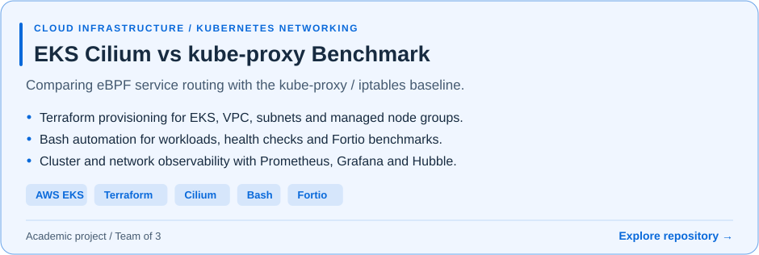
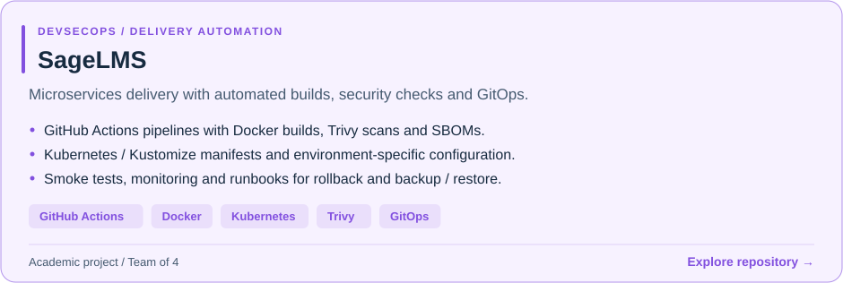
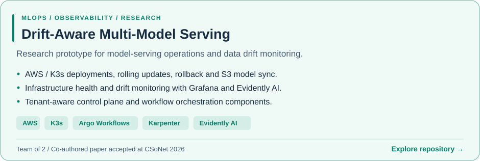

<!-- Profile README for Nashitaz13/Nashitaz13.
     Uses your existing svg/ngocthai.svg banner. -->

  

<h1 align="center">Bui Ngoc Thai</h1>

  <strong>Cloud Infrastructure &nbsp; / &nbsp; CI/CD &nbsp; / &nbsp; Automation</strong>

  Computer Networks student at UIT, VNU-HCM 
  Building practical experience in DevOps and cloud engineering.

  <a href="https://www.linkedin.com/in/nashitaz13/">LinkedIn</a>
  &nbsp; · &nbsp;
  <a href="mailto:buingocthai00@gmail.com">Email</a>
  &nbsp; · &nbsp;
  <a href="#featured-projects">Projects</a>
  &nbsp; · &nbsp;
  <a href="#technical-toolkit">Toolkit</a>

---

## About

I'm a final-year **Computer Networks and Data Communications** student at the **University of Information Technology, VNU-HCM**, seeking a **DevOps internship**.

My academic and research projects span AWS infrastructure, Kubernetes networking, DevSecOps pipelines, and MLOps. I work with Terraform, Bash, and Python to automate deployments and operations, and with Prometheus and Grafana to understand how systems behave.

I enjoy making environments reproducible, investigating deployment issues, and writing runbooks that help teammates operate what we build.

**Based in** Ho Chi Minh City, Vietnam &nbsp; · &nbsp; **Graduating** 2027

## Featured Projects

<a href="https://github.com/daithang59/NT531_EKS-Cilium-Kubeproxy-Benchmark">
  <picture>
    <source media="(prefers-color-scheme: dark)" srcset="assets/projects/eks-benchmark-dark.svg" />
    <source media="(prefers-color-scheme: light)" srcset="assets/projects/eks-benchmark-light.svg" />
    
  </picture>
</a>

<a href="https://github.com/daithang59/sagelms">
  <picture>
    <source media="(prefers-color-scheme: dark)" srcset="assets/projects/sagelms-dark.svg" />
    <source media="(prefers-color-scheme: light)" srcset="assets/projects/sagelms-light.svg" />
    
  </picture>
</a>

<a href="https://github.com/Viet-Hoang-2005/MLOps-paas-system">
  <picture>
    <source media="(prefers-color-scheme: dark)" srcset="assets/projects/mlops-dark.svg" />
    <source media="(prefers-color-scheme: light)" srcset="assets/projects/mlops-light.svg" />
    
  </picture>
</a>

<h2 align="center">Technical Toolkit</h2>

<h3 align="center">Cloud &amp; Infrastructure</h3>

  

AWS EC2, EKS, VPC, S3, IAM · Terraform · Ansible (basic)

<h3 align="center">Containers &amp; Orchestration</h3>

  
  

Docker · Docker Compose · Kubernetes/K3s · Helm

<h3 align="center">CI/CD &amp; Automation</h3>

  
  

GitHub Actions · Jenkins · Argo CD · Git

<h3 align="center">Scripting &amp; Operating Systems</h3>

  

Bash · Python · Linux

<h3 align="center">Monitoring &amp; Operations</h3>

  

Prometheus · Grafana · Centralized logging Health checks · Deployment &amp; rollback

<strong>Networking</strong> TCP/IP · DNS · DHCP · Cloud networking · Firewall fundamentals

## What I'm Working Toward

- Building reproducible cloud environments with Infrastructure as Code.
- Improving delivery workflows through CI/CD, security checks, and GitOps.
- Understanding Kubernetes networking and the performance of service routing.
- Connecting monitoring signals to practical troubleshooting and recovery steps.

## GitHub Statistics

  
  

  

Language statistics describe public repository code, rather than proficiency.

  
<strong>GitHub Activity</strong>

   
  

    <a href="https://github.com/Nashitaz13?tab=overview">Browse my contributions on GitHub</a>
  

  <picture>
    <source media="(prefers-color-scheme: dark)" srcset="https://raw.githubusercontent.com/Nashitaz13/Nashitaz13/output/github-contribution-grid-snake-dark.svg" />
    <source media="(prefers-color-scheme: light)" srcset="https://raw.githubusercontent.com/Nashitaz13/Nashitaz13/output/github-contribution-grid-snake.svg" />
    
  </picture>

---

  <strong>Let's connect</strong> 
  Open to DevOps internships and collaboration on cloud infrastructure and automation.  
  <a href="mailto:buingocthai00@gmail.com">buingocthai00@gmail.com</a>
  &nbsp; · &nbsp;
  <a href="https://www.linkedin.com/in/nashitaz13/">LinkedIn</a>

